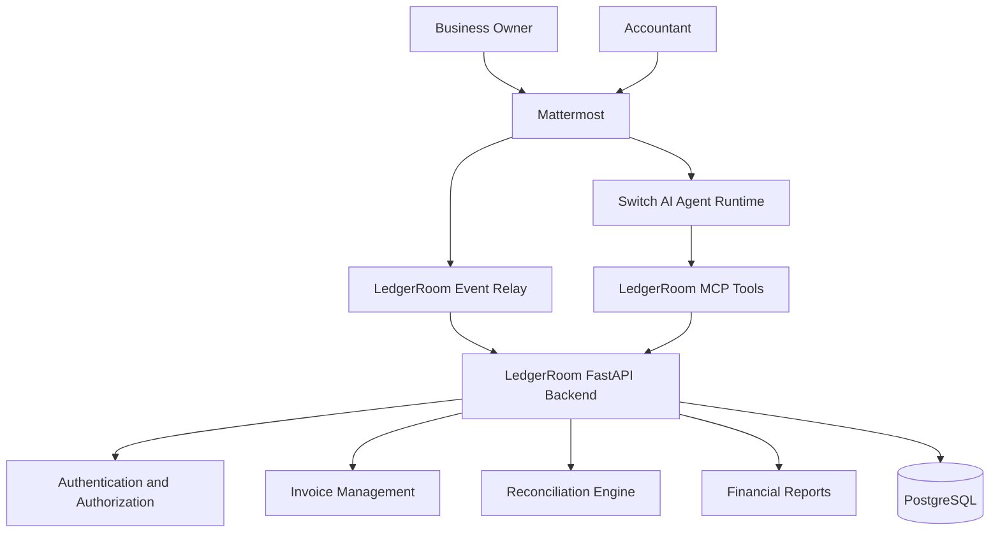

# LedgerRoom

### An AI-powered finance workspace for business owners and accountants

LedgerRoom is a collaborative financial management platform designed to bring business owners, accountants, and AI assistance into one shared workspace.

Instead of managing invoices, bank statements, reconciliation updates, and financial discussions across multiple tools, LedgerRoom provides a centralized environment where teams can organize financial information and work together.

The goal is simple: make everyday financial operations easier to understand, manage, and collaborate on.

---

## The Problem

Small businesses often manage their finances using spreadsheets, emails, WhatsApp messages, and separate accounting tools.

This creates several challenges:

- Business owners and accountants work with disconnected information.
- Invoice and bank transaction matching takes time.
- Pending clarifications get lost in conversations.
- Financial reports require manual preparation.
- Tracking financial updates across a team becomes difficult.

LedgerRoom aims to bring these workflows together.

## Our Solution

LedgerRoom combines a finance management backend with a conversational workspace.

- **Mattermost** provides the human collaboration interface.
- **Switch** provides the AI agent runtime.
- **LedgerRoom backend** manages business data, permissions, invoices, reconciliation, and financial operations.

Each business can have its own private finance channel where authorized members collaborate.

## Key Features

### 1. Business and Team Management
- User registration and authentication.
- Business workspace creation.
- Owner and accountant roles.
- Business membership management.
- Invitation-based accountant onboarding.

### 2. Mattermost Integration
- Link Mattermost accounts with LedgerRoom accounts.
- Create private finance channels for businesses.
- Map LedgerRoom business rooms to Mattermost channels.
- Synchronize linked, active business members.
- Keep business conversations in dedicated workspaces.

### 3. Invoice Management
- Upload invoice documents.
- Extract invoice information using AI-assisted processing.
- Organize vendor and invoice details.
- Track invoice information for reconciliation.

### 4. Bank Statement Processing
- Import bank statements through CSV files.
- Normalize vendor information.
- Process transaction records.
- Store monetary values in integer paise to avoid floating-point precision issues.

### 5. Intelligent Reconciliation
- Match bank transactions with invoices.
- Use deterministic vendor normalization and fuzzy similarity scoring.
- Prevent a bank transaction from being assigned to multiple invoices.
- Support a clarification workflow when information is insufficient.

### 6. Financial Reports
- Generate monthly financial reports.
- Review pending clarifications.
- Support report approvals and exports.

### 7. AI-Assisted Collaboration
The LedgerRoom agent is designed to help users interact with financial information through conversation.

It can assist with understanding financial information, summarizing records, and guiding users through finance workflows.

Financial operations remain controlled by the LedgerRoom backend, with authorization and validation handled outside the language model.

---

## System Architecture



**Important:** The LedgerRoom backend is the source of truth for financial data and authorization. AI-generated interpretations do not independently authorize financial operations or determine reconciliation matches.

## Technology Stack

| Layer | Technologies |
|---|---|
| Frontend | JavaScript, HTML, CSS |
| Backend | Python, FastAPI |
| Database | PostgreSQL |
| ORM and Migrations | SQLAlchemy, Alembic |
| AI / Document Processing | Gemini API |
| AI Agent Runtime | Switch |
| Collaboration | Mattermost |
| Agent Integration | Model Context Protocol (MCP) |
| Authentication | JWT, OAuth 2.0 |
| Development | Docker, Git, GitHub |

## Project Structure

```text
LedgerRoom/
│
├── backend/
│   └── app/
│       ├── api/
│       ├── models/
│       ├── schemas/
│       ├── services/
│       └── main.py
│
├── frontend/
│
├── mcp_server/
│
├── migrations/
│
├── tests/
│
├── data/
│
├── requirements.txt
├── alembic.ini
├── docker-compose.yml
└── README.md
```

## Getting Started

### Prerequisites

- Python 3.12+
- Node.js
- PostgreSQL
- Docker (for containerized database setup)
- Mattermost and Switch accounts for integration testing

### 1. Clone the Repository

```bash
git clone https://github.com/Vaishnavi-9r/Ledger-Room.git
cd Ledger-Room
```

### 2. Create a Python Virtual Environment

```bash
python -m venv .venv
```

Activate it on Windows:

```powershell
.venv\Scripts\activate
```

### 3. Install Dependencies

```bash
pip install -r requirements.txt
```

### 4. Configure Environment Variables

Create your local environment configuration using the provided example configuration.

Configure the required database connection, authentication keys, and integration credentials.

**Never commit `.env` files, passwords, API keys, OAuth secrets, or access tokens to GitHub.**

### 5. Start the Backend

```bash
uvicorn backend.app.main:app --reload
```

### 6. Start the Frontend

Follow the frontend setup instructions and start the development server.

### 7. API Documentation

Once the backend is running, visit:

```text
http://127.0.0.1:8000/docs
```

The actual backend port may differ depending on your local configuration.

---

## Security and Design Principles

- Backend-controlled authorization.
- Role-based access for business owners and accountants.
- Private business communication channels.
- Short-lived, single-use invitations.
- Secure account linking through OAuth.
- Deterministic financial reconciliation.
- Monetary values stored as integer paise.
- Financial operations validated by backend services.

## Current Development Status

LedgerRoom is an actively developed project.

Implemented areas include authentication, business membership, invoice processing, bank statement ingestion, reconciliation, clarification workflows, reporting, Mattermost account linking, and private-channel provisioning.

The Switch conversational integration and trusted human-identity propagation into financial MCP operations are still being developed and validated. Financial tools fail closed when trusted identity context is unavailable.

## Future Enhancements

- Complete trusted identity propagation between Mattermost, Switch, and LedgerRoom MCP tools.
- Expand natural-language access to authorized financial operations.
- Improve automated invoice and bank transaction matching.
- Add richer financial analytics.
- Support additional accounting integrations.
- Improve real-time collaboration and notifications.

## Why LedgerRoom?

LedgerRoom is built around the idea that financial management should not be an isolated activity between business owners and accountants.

By combining collaborative communication, backend-controlled financial workflows, and AI assistance, LedgerRoom aims to make financial work more transparent, organized, and accessible.

---

**Built with Python, FastAPI, PostgreSQL, Mattermost, Switch, and MCP.**
